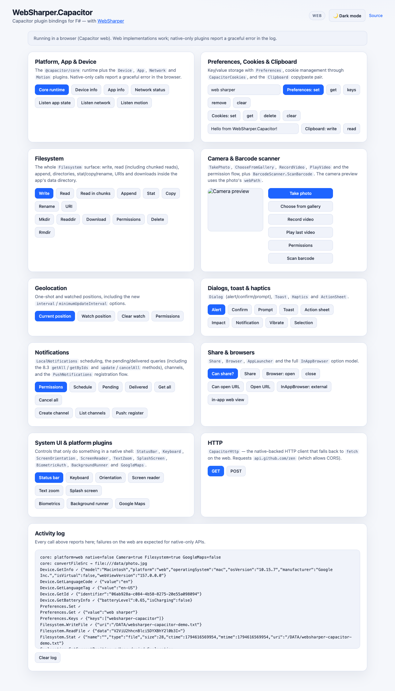

# WebSharper Capacitor

[](https://www.nuget.org/packages/WebSharper.Capacitor)

F# bindings for the [Capacitor](https://capacitorjs.com/) plugin ecosystem, for use with
[WebSharper](https://websharper.com/). They let you build cross-platform web, Android and iOS
apps in F# on top of Capacitor's JavaScript plugins.

The bindings are **npm-based**: every plugin is imported from its npm package, so the
WebSharper compiler emits regular ES module imports that your bundler resolves. Versions are
pinned to the current Capacitor 8 line (`>= 8.0.0 < 9.0.0` for the official plugins).

## Live demos

**Try it live:** [Open the sample in your browser](https://dotnet-websharper.github.io/Capacitor/)



The sample doubles as the binding's [test case](#running-the-test-case): it drives the whole
bound surface from the browser (platform/device/app, preferences, cookies, clipboard,
filesystem, camera, barcode scanner, geolocation, dialogs, toast, haptics, action sheet,
local/push notifications, share, browser/in-app browser, app launcher, status bar, keyboard,
screen orientation/reader, text zoom, splash screen, biometrics, background runner and HTTP),
and reports a graceful error for the APIs that only exist in a native shell.

- [Binding source](https://github.com/dotnet-websharper/capacitor/tree/master/WebSharper.Capacitor)
- [Sample source](https://github.com/dotnet-websharper/capacitor/tree/master/WebSharper.Capacitor.Sample)
- [WebSharper bindings catalog](https://websharper.com/bindings)

## Bound plugins

| Namespace | npm package | Binding |
|---|---|---|
| `BiometricAuth` | [`@aparajita/capacitor-biometric-auth`](https://www.npmjs.com/package/@aparajita/capacitor-biometric-auth) | `Capacitor.BiometricAuth` |
| `ActionSheet` | [`@capacitor/action-sheet`](https://www.npmjs.com/package/@capacitor/action-sheet) | `Capacitor.ActionSheet` |
| `AppLauncher` | [`@capacitor/app-launcher`](https://www.npmjs.com/package/@capacitor/app-launcher) | `Capacitor.AppLauncher` |
| `App` | [`@capacitor/app`](https://www.npmjs.com/package/@capacitor/app) | `Capacitor.App` |
| `BackgroundRunner` | [`@capacitor/background-runner`](https://www.npmjs.com/package/@capacitor/background-runner) | `Capacitor.BackgroundRunner` |
| `BarcodeScanner` | [`@capacitor/barcode-scanner`](https://www.npmjs.com/package/@capacitor/barcode-scanner) | `Capacitor.BarcodeScanner` |
| `Browser` | [`@capacitor/browser`](https://www.npmjs.com/package/@capacitor/browser) | `Capacitor.Browser` |
| `Camera` | [`@capacitor/camera`](https://www.npmjs.com/package/@capacitor/camera) | `Capacitor.Camera` |
| `Clipboard` | [`@capacitor/clipboard`](https://www.npmjs.com/package/@capacitor/clipboard) | `Capacitor.Clipboard` |
| `Cookies` | [`@capacitor/core`](https://www.npmjs.com/package/@capacitor/core) | `Capacitor.Cookies` |
| `Device` | [`@capacitor/device`](https://www.npmjs.com/package/@capacitor/device) | `Capacitor.Device` |
| `Dialog` | [`@capacitor/dialog`](https://www.npmjs.com/package/@capacitor/dialog) | `Capacitor.Dialog` |
| `Filesystem` | [`@capacitor/filesystem`](https://www.npmjs.com/package/@capacitor/filesystem) | `Capacitor.Filesystem` |
| `Geolocation` | [`@capacitor/geolocation`](https://www.npmjs.com/package/@capacitor/geolocation) | `Capacitor.Geolocation` |
| `GoogleMaps` | [`@capacitor/google-maps`](https://www.npmjs.com/package/@capacitor/google-maps) | `Capacitor.GoogleMaps` |
| `Haptics` | [`@capacitor/haptics`](https://www.npmjs.com/package/@capacitor/haptics) | `Capacitor.Haptics` |
| `Http` | [`@capacitor/core`](https://www.npmjs.com/package/@capacitor/core) | `Capacitor.Http` |
| `InAppBrowser` | [`@capacitor/inappbrowser`](https://www.npmjs.com/package/@capacitor/inappbrowser) | `Capacitor.InAppBrowser` |
| `Keyboard` | [`@capacitor/keyboard`](https://www.npmjs.com/package/@capacitor/keyboard) | `Capacitor.Keyboard` |
| `LocalNotifications` | [`@capacitor/local-notifications`](https://www.npmjs.com/package/@capacitor/local-notifications) | `Capacitor.LocalNotifications` |
| `Motion` | [`@capacitor/motion`](https://www.npmjs.com/package/@capacitor/motion) | `Capacitor.Motion` |
| `Network` | [`@capacitor/network`](https://www.npmjs.com/package/@capacitor/network) | `Capacitor.Network` |
| `Preferences` | [`@capacitor/preferences`](https://www.npmjs.com/package/@capacitor/preferences) | `Capacitor.Preferences` |
| `PushNotifications` | [`@capacitor/push-notifications`](https://www.npmjs.com/package/@capacitor/push-notifications) | `Capacitor.PushNotifications` |
| `ScreenOrientation` | [`@capacitor/screen-orientation`](https://www.npmjs.com/package/@capacitor/screen-orientation) | `Capacitor.ScreenOrientation` |
| `ScreenReader` | [`@capacitor/screen-reader`](https://www.npmjs.com/package/@capacitor/screen-reader) | `Capacitor.ScreenReader` |
| `Share` | [`@capacitor/share`](https://www.npmjs.com/package/@capacitor/share) | `Capacitor.Share` |
| `SplashScreen` | [`@capacitor/splash-screen`](https://www.npmjs.com/package/@capacitor/splash-screen) | `Capacitor.SplashScreen` |
| `StatusBar` | [`@capacitor/status-bar`](https://www.npmjs.com/package/@capacitor/status-bar) | `Capacitor.StatusBar` |
| `TextZoom` | [`@capacitor/text-zoom`](https://www.npmjs.com/package/@capacitor/text-zoom) | `Capacitor.TextZoom` |
| `Toast` | [`@capacitor/toast`](https://www.npmjs.com/package/@capacitor/toast) | `Capacitor.Toast` |
| `Watch` | [`@capacitor/watch`](https://www.npmjs.com/package/@capacitor/watch) | `Capacitor.Watch` |

The `@capacitor/core` runtime is bound as `CapacitorCore` (`GetPlatform`, `IsNativePlatform`,
`IsPluginAvailable`, `ConvertFileSrc`).

## Install

```sh
dotnet add package WebSharper.Capacitor
# or
nuget install WebSharper.Capacitor
```

Install the npm packages of the plugins you actually use, for example:

```sh
npm install @capacitor/core @capacitor/camera @capacitor/preferences
```

The binding declares them as npm dependencies (`>= reference < next-major`), so a
WebSharper-aware bundler can also resolve them automatically.

## Usage

```fsharp
open WebSharper
open WebSharper.JavaScript
open WebSharper.Capacitor

[<JavaScript>]
module Demo =
    let takePhoto () = promise {
        let options = Camera.TakePhotoOptions(Quality = 80, CorrectOrientation = true)
        let! photo = Capacitor.Camera.TakePhoto(options)
        return photo.WebPath
    }

    let store (value: string) =
        Capacitor.Preferences.Set(Preferences.SetOptions(key = "auth_token", value = value))

    let platform () = CapacitorCore.GetPlatform()
```

Notes:

- Required configuration fields are positional constructor arguments
  (`Preferences.SetOptions(key = ..., value = ...)`); everything else is an optional
  settable property (`Camera.TakePhotoOptions(Quality = 80)`).
- Every plugin method returns a WebSharper `Promise<'T>`; use `promise { ... }` or
  `.Then(onFulfilled, onRejected)`.
- On the web, plugins with a web implementation work in the browser; the rest reject with
  `"Not implemented on web."` — handle that in your UI.
- Some plugins need Capacitor configuration (`capacitor.config.json`). The binding exposes
  the matching `PluginsConfig` types in each namespace but does not write the JSON for you.

## Running the test case

The sample is the test case and the live demo. It is a static SPA (`net10.0`, bundled with
esbuild), so it exercises the binding in a real browser without a device.

```sh
cd WebSharper.Capacitor.Sample
npm install
dotnet build -c Release          # runs WebSharper, then esbuild into ../dist
dotnet serve -d ../dist -p 8080  # serve it
```

Then open <http://localhost:8080/>. Press the buttons in each card; the activity log reports
the result of every call, including the expected "not available on this platform" errors for
native-only APIs.

To run it as an Android app:

```sh
cd WebSharper.Capacitor.Sample
npx cap sync android
cd android
./gradlew assembleDebug
```

`capacitor.config.json` points `webDir` at `dist`.

## Build from source

Prerequisites: the .NET 11 SDK (the WebSharper 11 compiler runs on it), Node.js and npm.

```sh
dotnet tool restore
dotnet paket restore
dotnet build WebSharper.Capacitor.Sample/WebSharper.Capacitor.Sample.fsproj -c Release
```

Or use the build script (it restores the tools, refreshes the build-script, then runs FAKE):

```sh
./build CI-Release
```

## Pack

```sh
./build WS-Package
# or
WSPackageFolder=/tmp/pkg dotnet fsi ./build.fsx -t WS-Package
```

This produces `WebSharper.Capacitor` with the binding dll, XML docs and the WebSharper 11
metadata sidecar.

## Deployment

`.github/workflows/ghpages.yml` builds the sample on every push to `master` and deploys the
generated `dist/` to the `gh-pages` branch, which serves
<https://dotnet-websharper.github.io/Capacitor/>. `.github/workflows/build.yml` builds the
Android APK and uploads it as an artifact.

## Repository layout

| Path | Contents |
|---|---|
| `WebSharper.Capacitor/` | The WIG binding (`Main.fs`), `netstandard2.0`, npm-based |
| `WebSharper.Capacitor.Sample/` | `net10.0` esbuild SPA sample/test case and the Capacitor Android project |
| `nuget/` | Paket package template |
| `docs/` | README screenshot |
| `build.fsx`, `build.sh`, `build.cmd` | Build/pack entry points |

## License

Apache 2.0 — see [LICENSE.md](LICENSE.md).